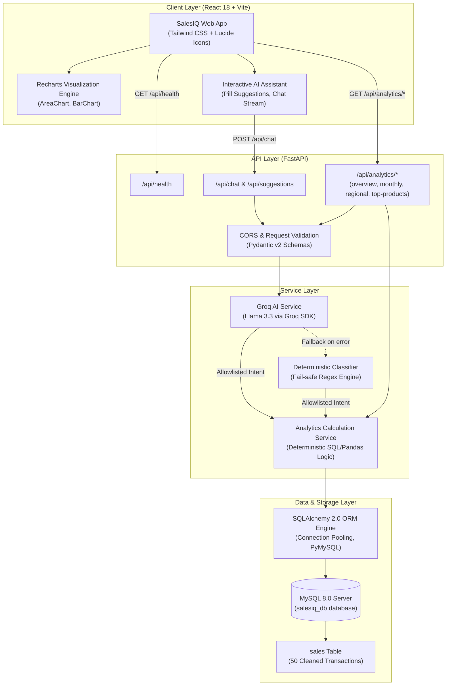
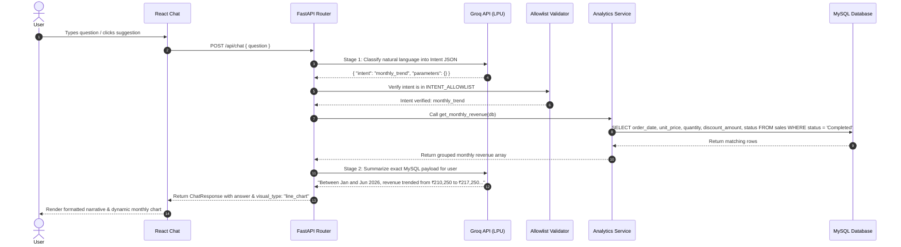

# System Architecture: SalesIQ

## 1. High-Level Architecture Overview

SalesIQ is an AI-powered Business Intelligence application designed with clean separation of concerns, enterprise security guardrails, and cloud deployment compatibility.

---

## 2. Request Lifecycle & Intent Execution Flow

When a user submits a question in the AI Assistant (e.g. *"What is the monthly revenue trend?"*):

---

## 3. Database Schema & Data Dictionary

Database Name: `salesiq_db`  
Table Name: `sales`

| Column | MySQL Type | Constraints | Description |
| :--- | :--- | :--- | :--- |
| `transaction_id` | `VARCHAR(20)` | `PRIMARY KEY, NOT NULL` | Unique Transaction Identifier (e.g. `TXN0001` - `TXN0051`) |
| `order_date` | `DATE` | `NOT NULL, INDEX` | Transaction date (parsed from `DD-MM-YYYY`) |
| `product` | `VARCHAR(100)` | `NOT NULL, INDEX` | Name of the purchased item |
| `category` | `VARCHAR(50)` | `NOT NULL, INDEX` | Item category: Accessories, Furniture, Electronics |
| `region` | `VARCHAR(50)` | `NOT NULL, INDEX` | Territory: North, South, East, West |
| `sales_channel` | `VARCHAR(50)` | `NOT NULL` | Purchasing channel: Online, Retail |
| `quantity` | `INT` | `NOT NULL` | Units purchased (≥ 0) |
| `unit_price` | `DECIMAL(10, 2)` | `NOT NULL` | Per-unit currency price |
| `discount_amount` | `DECIMAL(10, 2)` | `NOT NULL, DEFAULT 0.00` | Flat discount currency amount applied to the transaction |
| `status` | `VARCHAR(20)` | `NOT NULL, INDEX` | Order status (`Completed` or `Returned`) |

---

## 4. Business Mathematics & Revenue Definitions

$$\text{Gross Revenue} = \text{Quantity} \times \text{Unit Price}$$

$$\text{Net Revenue} = (\text{Quantity} \times \text{Unit Price}) - \text{Discount Amount}$$

- **Realized Revenue Rules**:
  - `Completed` (50 transactions): Included in realized net revenue, gross revenue, monthly charts, and product ranking.
  - `Returned` (1 transaction: `TXN0033`, ₹19,000.00): Preserved in the database for tracking return rates and inventory auditing, but strictly excluded from realized sales.
  - **Zero-Quantity Order** (`TXN0034`, quantity = 0): Correctly evaluated to ₹0.00 without corrupting transaction averages or sales totals.

---

## 5. Security & Isolation Model

1. **No Direct SQL Generation**:
   The Groq LLM never generates SQL text. It acts exclusively as an intent classifier producing structured JSON. All SQL statements are predefined, parameterized SQLAlchemy queries in `AnalyticsService`.
2. **Credential Isolation**:
   No passwords or API keys are stored in source code. Credentials reside solely in `.env` files and environment variables, protected by `.gitignore`.
3. **Database Health Ping**:
   FastAPI uses SQLAlchemy connection pooling with `pool_pre_ping=True` and `pool_recycle=1800` to prevent stale socket errors across idle connections.
4. **Test Isolation**:
   The automated test suite runs hermetically using mock sessions and isolated fixtures, guaranteeing zero risk of altering or dropping production data.
